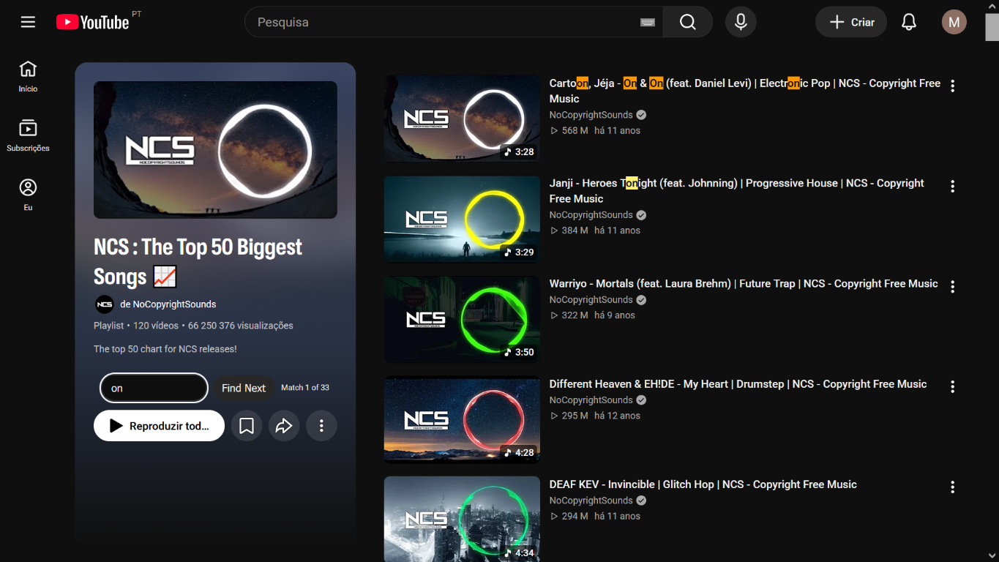

# YouTube Playlist Searcher

Find a video in a YouTube playlist without scrolling through it by hand. Search
loaded playlist titles, jump from match to match, and see each match highlighted
right on the page.



## Get the extension

Download the package for your browser from the
[Releases page](https://github.com/migueld51244/youtube-search-playlist/releases).

### Firefox

Download the Firefox `.xpi` package from a release. In Firefox, open
`about:addons`, select the gear menu, choose **Install Add-on From File...**, and
select the downloaded file.

### Chrome

Download and extract the Chrome package from a release. Open
`chrome://extensions`, turn on **Developer mode**, click **Load unpacked**, and
select the extracted folder containing `manifest.json`.

## Search a playlist

1. Open a YouTube playlist, including a playlist displayed alongside a video.
2. Type a word or phrase into **Search this playlist**.
3. Press Enter or select **Find Next** to move through the matching videos.

Matches are highlighted in the playlist, and the active result scrolls into
view. Search is case-insensitive and wraps around when you reach the last match.

## Features

- Search playlist video titles without leaving YouTube.
- Find the next match and see how many results match your search.
- Highlight matches and scroll directly to the active video.
- Works with YouTube's light and dark themes and dynamically loaded playlist
  pages.
- No account or backend required.

## A note about playlist loading

YouTube loads playlist videos as you scroll. Searcher can find videos that
YouTube has loaded on the page; scroll through the playlist to load more videos
and include them in your search.

## For developers

To run the extension from source:

- **Chrome or Edge:** Open `chrome://extensions` or `edge://extensions`, enable
  Developer mode, click **Load unpacked**, and select the `src` directory.
- **Firefox 109 or later:** Open `about:debugging#/runtime/this-firefox`, click
  **Load Temporary Add-on...**, and select `src/manifest.json`. Temporary
  add-ons are removed when Firefox closes.

Run the automated tests with Node.js:

```bash
npm install
npm test
```

To report a bug or request a feature, [open an issue](https://github.com/migueld51244/youtube-search-playlist/issues).

## License

This project is licensed under the MIT License. See [LICENSE](LICENSE) for
details.
